[English](README.md) | **한국어**

# CogentAI AI Agent Studio

CogentAI AI Agent Studio 는 [Hermes Agent](https://github.com/NousResearch/hermes-agent)(Nous Research)를 위한 웹 콘솔이다. Hermes 로 동작하는 AI 에이전트 여러 개를 한 화면에서 보고, 일을 시키고, 3D 오피스·칸반·회의로 함께 일하게 한다.

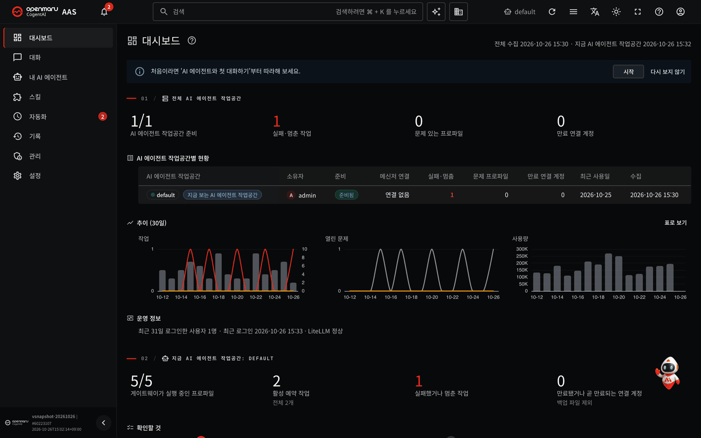

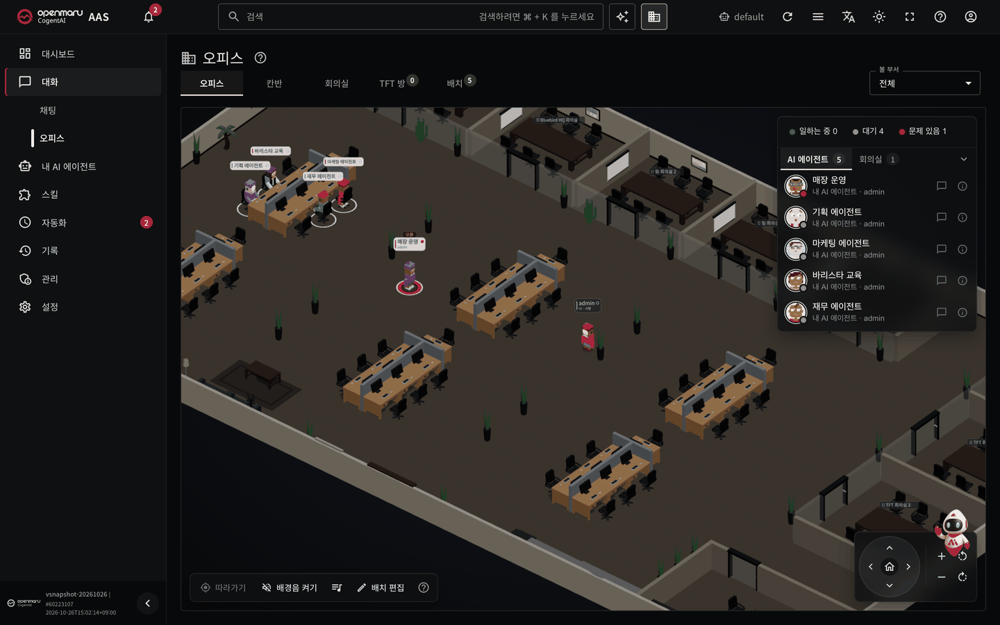

**목차:** [무엇을 하나](#무엇을-하나) · [화면 둘러보기](#화면-둘러보기) · [구성과 동작 원리](#구성과-동작-원리) · [빠른 시작](#빠른-시작) · [LLM 연결](#llm-연결) · [compose 파일](#compose-파일) · [쓸 수 있는 기능](#docker-compose-에서-쓸-수-있는-기능) · [설정](#설정) · [운영](#운영) · [문제 해결](#문제-해결) · [개발](#개발)

## 무엇을 하나

AI Agent Studio 는 Hermes 설치와 그 안의 프로파일을 웹 브라우저에서 보여 준다. Hermes 파일을 직접 고치거나 Hermes 명령줄을 쓰지 않아도 된다.

화면에서는 세 낱말을 아래 뜻으로 쓴다.

- **AI 에이전트 작업공간**: Hermes 설치 하나. 프로파일을 하나 이상 가진다. Docker Compose 는 AI 에이전트 작업공간 하나를 실행한다.
- **프로파일**: AI 에이전트 작업공간 안의 Hermes 프로파일 하나. 프로파일마다 성격·모델·스킬·도구·예약 작업이 따로 있다.
- **AI 에이전트**: 실행 중인 프로파일. 채팅의 대화 상대, 오피스 자리에 앉는 인물, 회의에서 답하는 쪽, 칸반 카드의 담당이 AI 에이전트다.

메뉴에는 다음 화면이 있다.

| 메뉴 | 화면 | 할 수 있는 일 |
|---|---|---|
| 대시보드 | 대시보드 | AI 에이전트 작업공간마다 상태를 보고, 실패하거나 멈춘 예약 작업·끊긴 메신저·오류처럼 손봐야 할 일을 찾는다 |
| 대화 | 채팅 | AI 에이전트를 골라 대화한다 |
| 대화 | 오피스 | 3D 오피스, 칸반 보드, 회의실, TFT 방을 쓴다 |
| 내 AI 에이전트 | 프로파일 | 프로파일마다 성격(`SOUL.md`)·모델·스킬·도구·MCP 서버·비밀값·예약 작업을 고친다 |
| 내 AI 에이전트 | AI 에이전트 작업공간 | 내 AI 에이전트 작업공간의 상태와 개수 한도를 본다. AI 에이전트 작업공간을 만든다(쿠버네티스에서만) |
| 내 AI 에이전트 | 모델 | 연결한 LLM 에서 프로파일이 쓸 수 있는 모델 목록을 본다 |
| 스킬 | 스킬 목록, 스킬 허브, 스킬 연결도 | 스킬을 찾고, 스킬 묶음을 설치하고(쿠버네티스에서만), 어느 스킬이 어느 스킬을 부르는지 본다 |
| 자동화 | 예약 작업, 메신저 연결 | 예약 작업(Cron)과 그 실패를 본다. 텔레그램·슬랙 같은 메신저 연결 상태를 본다. AI Agent Studio 는 토큰 값을 읽지 않는다 |
| 기록 | 사용량, 변경 기록 | 세션과 토큰 사용량을 본다. 누가 언제 무엇을 바꿨는지 본다(값은 기록하지 않는다) |
| 관리 | 사용자·권한, 역할 템플릿, 공지 | 관리자만 쓴다. 누가 로그인하고 어느 AI 에이전트 작업공간을 보는지 정한다. 역할마다 성격 템플릿을 둔다. 점검·장애·새 기능 소식을 모든 사용자 화면 맨 위에 알린다 |
| 설정 | 내 화면, API 키·토큰, 회사 정보 | 언어·시간대·테마를 고른다. AI 에이전트가 LLM·MCP·REST·WebSocket 에 접속할 때 쓰는 키와 토큰이 어디에 있는지 본다. 회사 이름과 부서 슬로건을 정한다 |

### 채팅

- AI 에이전트를 고르고 메시지를 적는다. 채팅 화면은 AI 에이전트가 일하는 단계(도구 호출, 명령과 그 출력)를 보여 준다.
- AI 에이전트가 승인이 필요한 명령을 실행하려 하면 **한 번 허용**, **이 대화에서 허용**, **항상 허용**, **거부** 가운데 하나를 고른다.
- AI 에이전트가 되물으면 답을 하나 이상 고르거나 직접 적는다.
- 파일을 첨부할 수 있다(파일당 100MB, 한 번에 10개까지). **파일** 서랍에서 올린 파일과 AI 에이전트가 만든 파일을 본다. 한 AI 에이전트 작업공간의 프로파일은 작업 폴더 하나를 함께 쓴다.
- **새 대화** 로 언제든 새 대화를 시작할 수 있다. 이전 대화는 **지난 대화** 에 남고, 검색할 수 있다.

### 3D 오피스·칸반·회의

**대화** > **오피스** 화면에는 탭이 다섯 개 있다.

- **오피스**: 3D 방. 배치한 프로파일이 각자 자리에 앉는다. 장면에서 프로파일이 일하는 중인지, 대기 중인지, 문제가 있는지, 자리를 비웠는지 알 수 있다. 프로파일을 누르면 정보와 예약 작업을 보고 바로 대화할 수 있다. 브라우저에 WebGL 이 없으면 2D 보기로 바뀐다.
- **칸반**: 모든 AI 에이전트 작업공간의 카드를 한 보드에서 본다. 카드를 만들 때 일을 맡을 프로파일을 고른다. AI Agent Studio 가 그 AI 에이전트 작업공간의 Hermes 보드에 카드를 넣고, Hermes 가 카드를 실행한다. 칸은 분류 대기·할 일·예약·준비·진행 중·막힘·검토·완료·보관이다. AI 에이전트는 일을 마치면 결과 파일을 카드에 붙일 수 있다. 사람은 결과를 승인하거나, 변경을 요청하거나, 막힘을 풀거나, 실행을 멈출 수 있다. **AI 로 항목 나누기** 는 자유롭게 적은 글을 카드 항목으로 나눈다.
- **회의실**: 사람과 프로파일이 한 방에서 대화한다. 사람이 메시지를 보내면 받는 쪽으로 고른 프로파일이 각자 답한다. `@` 로 프로파일을, `/` 로 스킬을 고른다. **자료** 탭에서 파일을 공유한다. **회의록 요약 내려받기** 는 회의 요약을 Markdown 파일로 만든다.
- **TFT 방**: 여러 팀이 함께 하는 과제(태스크포스팀, TFT)용 방. 방마다 목적·담당자·참여하는 사람과 프로파일을 정한다.
- **배치**(관리자): 프로파일은 저절로 오피스에 앉는다(이름이 영문 소문자·숫자·`-`·`_` 규칙에 맞는 것만). 여기서 프로파일마다 이름·표시 이름·역할·팀을 고치거나 오피스에서 뺀다. 뺀 프로파일은 다시 앉지 않는다. 이 정보는 AI Agent Studio 데이터베이스에만 저장되며 Hermes 쪽 설정은 바뀌지 않는다.

팀 회의실에서 회의를 시작하면 그 팀의 AI 에이전트가 자리에서 일어나 회의실로 걸어가고, 답하는 동안 「일하는 중」으로 표시된다.

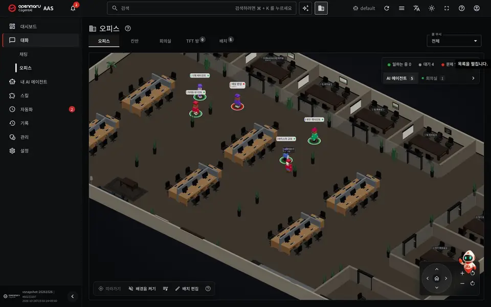

## 화면 둘러보기

아래 그림은 가상의 회사 「파랑새 커피」의 예시 자료로 찍었다.

### 파일 보기

**파일** 서랍에서 파일을 열면 내려받지 않아도 브라우저에서 바로 볼 수 있다. 볼 수 있는 형식은 다음과 같다.

- 한글(HWP·HWPX), 워드(DOCX), 엑셀(XLSX), 파워포인트(PPTX)
- PDF, CSV, Markdown, HTML, 글자 파일과 코드
- 그림, 소리, 영상

문서는 브라우저 안에서 그려진다. AI Agent Studio 는 파일을 외부 변환 서비스로 보내지 않는다. 보기 화면에서 파일을 받고, AI 에게 묻고, AI 에이전트가 보는 경로를 복사하고, 회의실에 올릴 수 있다. 미리 보기이므로 원본과 모양이 조금 다를 수 있다. 옛 오피스 형식(DOC·XLS·PPT)과 암호가 걸린 오피스 문서는 미리 보지 못한다. 암호가 걸린 PDF 는 보기 화면에서 비밀번호를 넣으면 열린다.

| | |
|---|---|
| 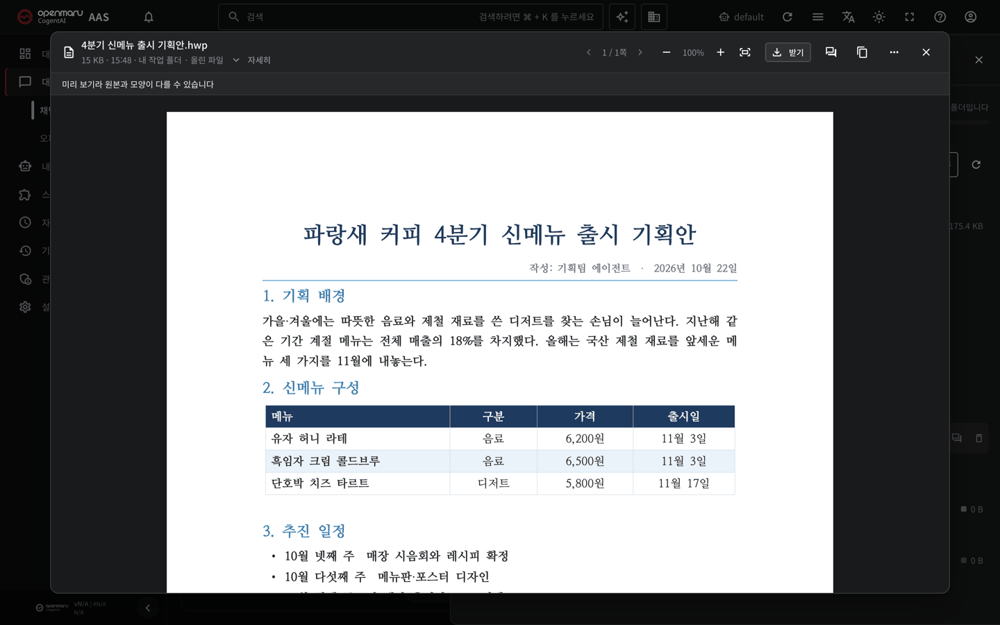 | 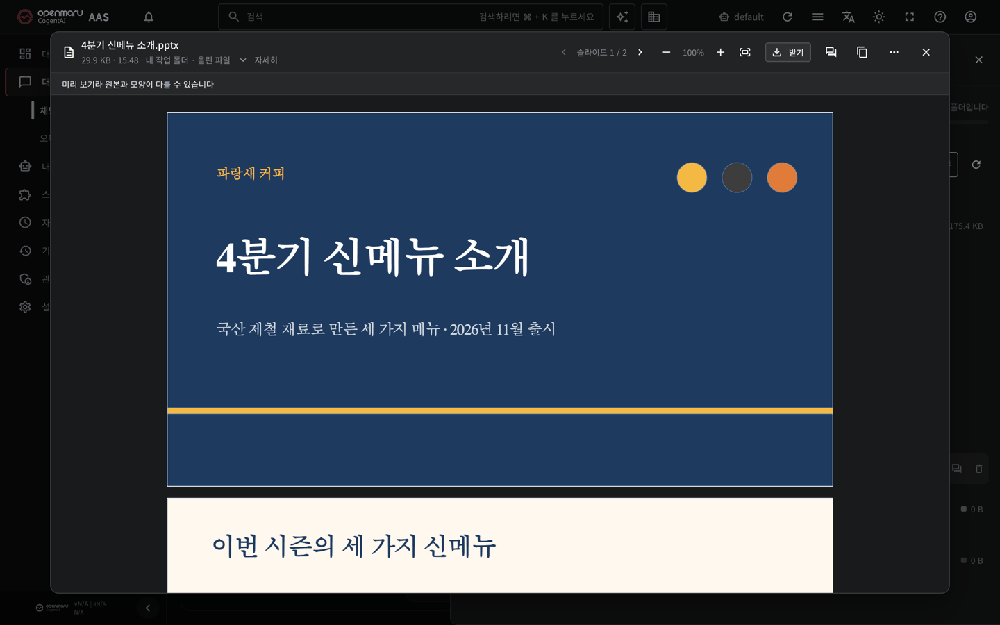 |
| 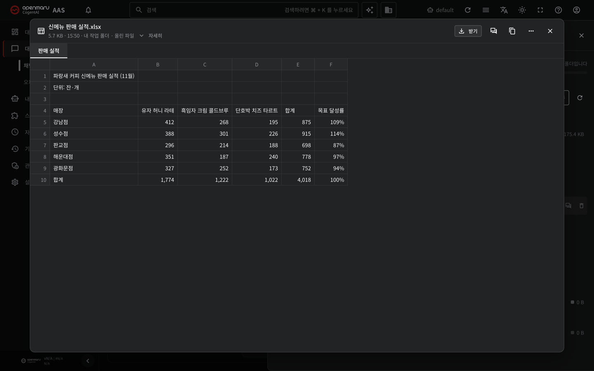 | 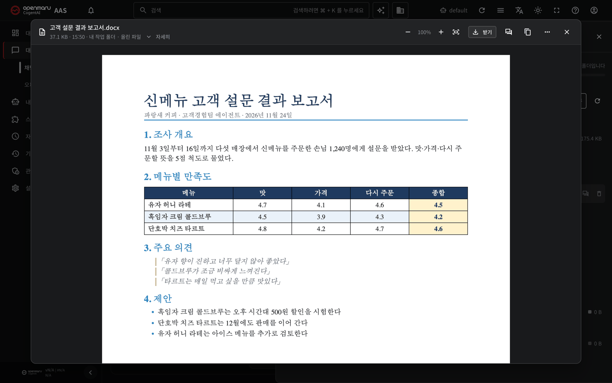 |

### 글 고치기와 이전 버전

성격(SOUL), 설정, 스킬, 예약 작업의 지시문을 화면에서 바로 고칠 수 있다. 프로파일 상세의 **성격(SOUL)**·**설정(config)** 탭이나 스킬 연결도의 **코드** 탭에서 연다. 저장하기 전에 바뀐 줄을 먼저 보여 준다. AI Agent Studio 는 글마다 이전 버전을 40개까지 남긴다. 두 버전을 비교하거나 이전 버전으로 되돌릴 수 있다.

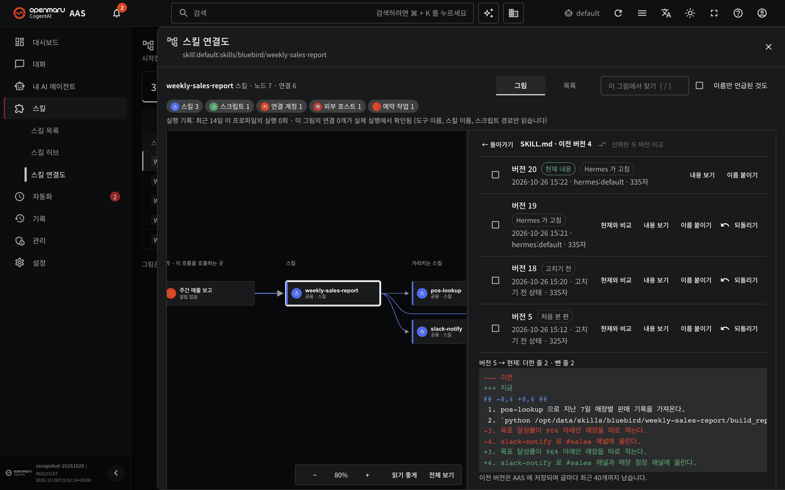

### 화면 안 도움말과 따라하기 가이드

화면 위쪽의 도움말(?) 단추를 누르면 「하고 싶은 일」별 가이드가 열린다. 사용자 가이드와 관리자 가이드가 따로 있다. 따라하기를 시작하면 단계마다 해당 화면을 열고 눌러야 할 곳을 강조해 보여 준다.

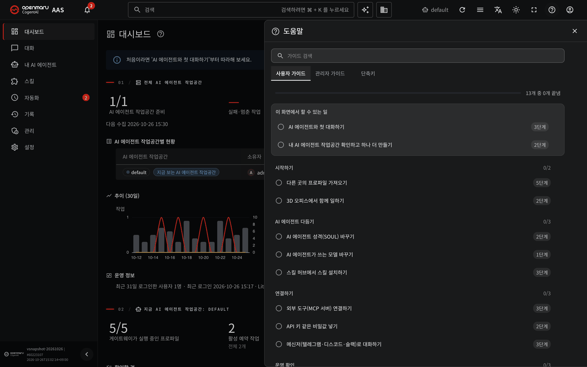

### 스킬 연결도

스킬이 어디서 불리는지(예약 작업, 다른 스킬)와 무엇을 쓰는지(스크립트, 라이브러리, API 키·토큰, 외부 주소, MCP 서버)를 그림으로 보여 준다. AI Agent Studio 가 스킬 문서와 스크립트를 읽어 그림을 만든다. **스킬** > **스킬 연결도** 에서 연다.

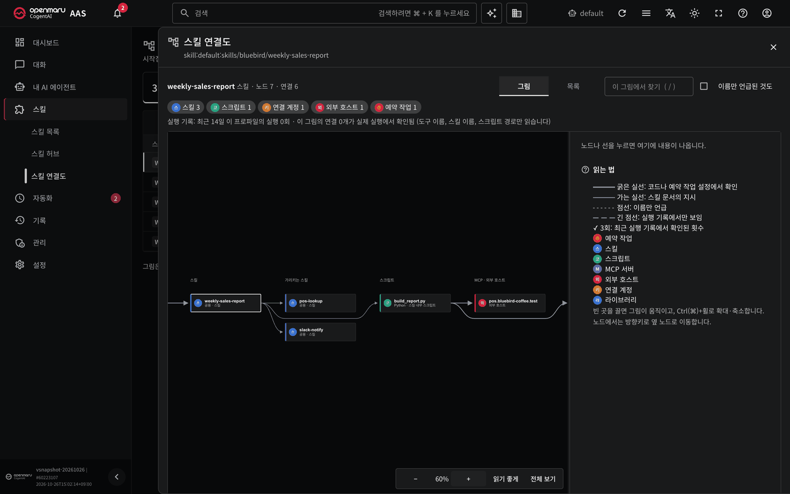

### 받은편지함과 대시보드

화면 위쪽 종 단추에 확인할 일의 건수가 뜬다. 명령 승인 요청과 AI 에이전트의 질문에는 그 자리에서 답할 수 있다. 실패한 예약 작업을 누르면 해당 화면으로 바로 이동한다. 대시보드는 AI 에이전트 작업공간의 상태와 30일 추이(작업, 열린 문제, 사용량)를 보여 준다.

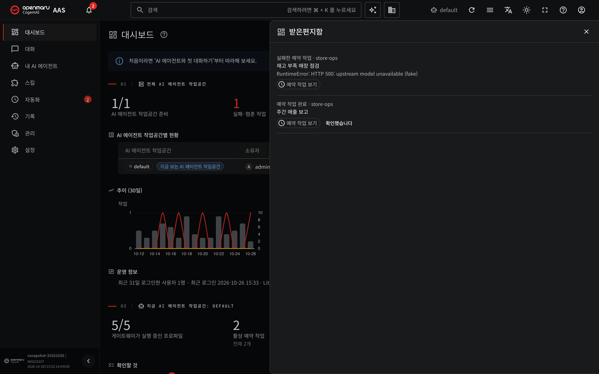

### 어느 화면에서나 여는 대화 창

화면 위쪽의 AI 단추를 누르면 지금 보던 화면을 떠나지 않고 대화 창이 열린다. 창은 끌어 옮기고, 크기를 바꾸고, 접을 수 있다. 다른 화면으로 가도 창은 그대로 남는다.

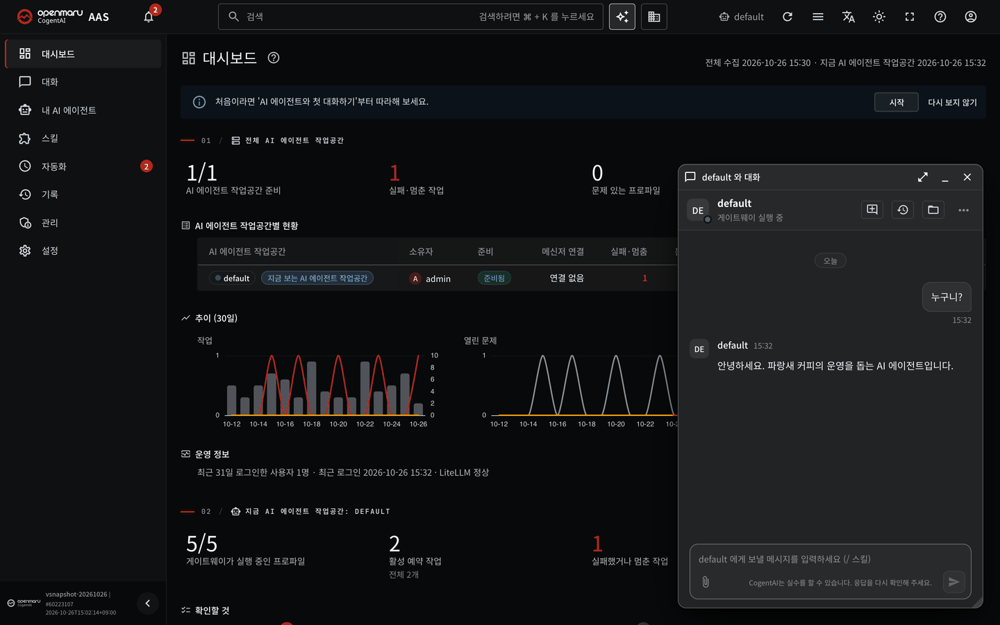

### 예약 작업 만들기

**자동화** > **예약 작업** > **새 예약 작업** 에서 어느 프로파일이, 언제, 어떤 스킬이나 지시문을 실행하고, 결과를 어디로 보낼지 양식으로 정한다. 실행 주기를 「매일 09:00」처럼 문장으로 풀어 주고, 다음 실행 시각도 미리 보여 준다. 실패하거나 멈춘 작업은 메뉴에 건수로 표시된다.

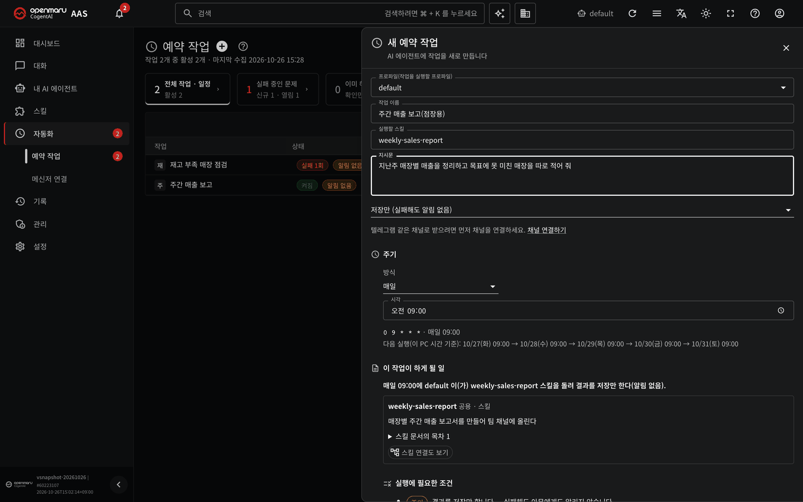

### 메신저 연결

프로파일 상세의 **메신저 연결** 탭에서 텔레그램, 디스코드, 슬랙, 매터모스트를 연결한다. 저장한 토큰은 화면에 다시 보이지 않는다. **연결 시험** 단추로 바로 확인할 수 있다.

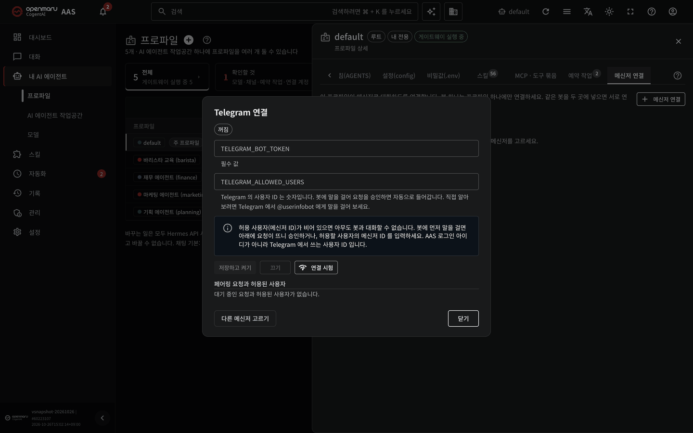

### 채팅 답의 도표와 차트

AI 에이전트가 답에 넣은 Mermaid 다이어그램, ECharts 차트, 코드가 채팅 안에서 그림으로 바로 보인다.

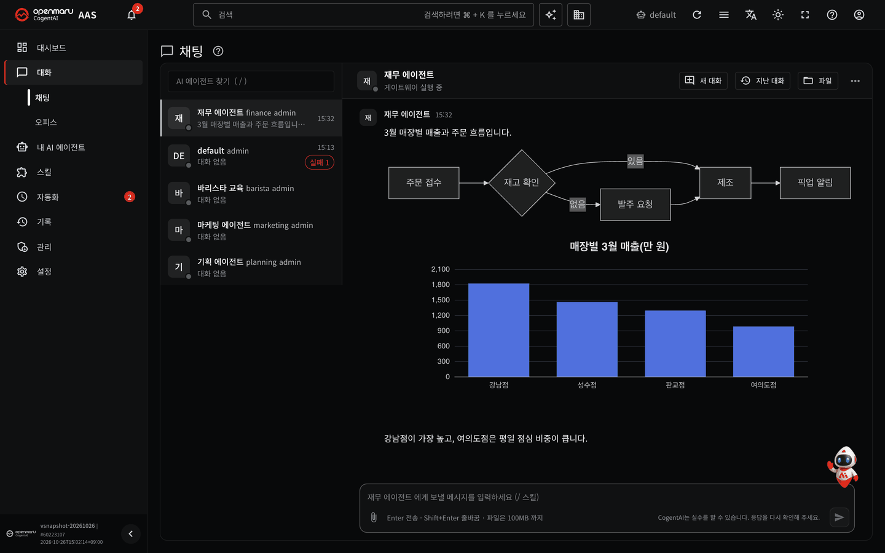

### 명령 창과 단축키

화면 위쪽 검색 칸이나 `⌘/Ctrl+K` 로 화면과 가이드를 찾아 이동한다. `g` 다음에 글자 하나를 누르면 그 화면으로 이동하고, `?` 를 누르면 단축키 목록이 열린다.

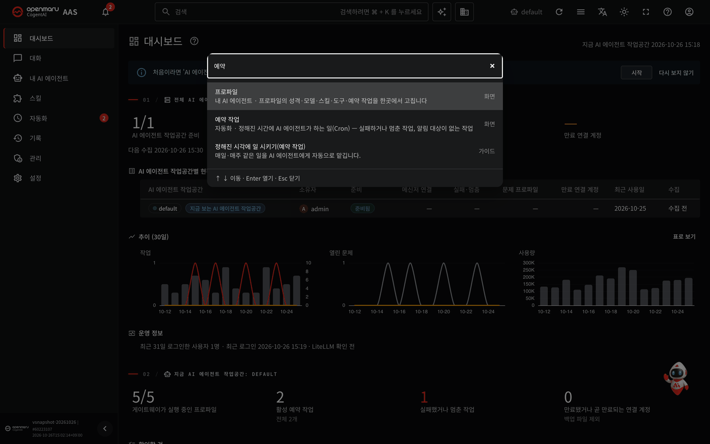

### 역할 템플릿

마케팅, 세일즈, 연구소 등 역할 10개의 성격(SOUL) 템플릿을 한국어와 영어로 기본 제공한다. 새 프로파일의 성격을 템플릿에서 시작할 수 있다. 관리자는 **관리** > **역할 템플릿** 에서 템플릿을 고치거나 새로 만든다.

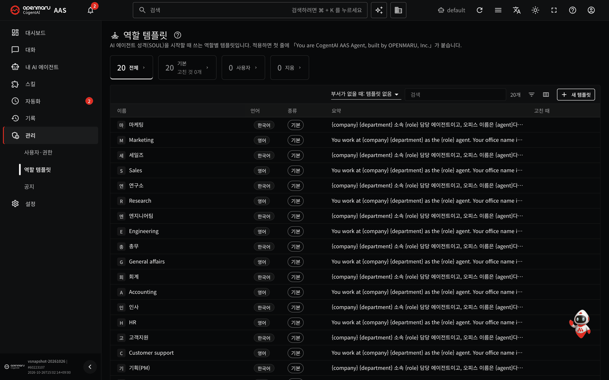

## 구성과 동작 원리

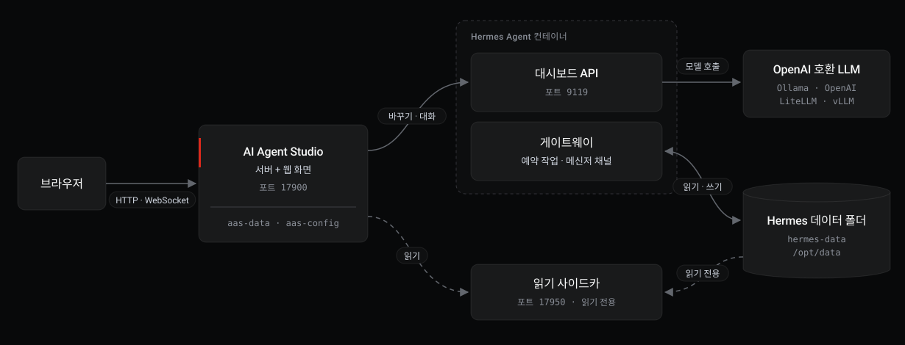

- **AI Agent Studio 서버**(`aas/`): Python. 웹 화면(`ui/`, React)도 함께 내보낸다. 계정·오피스·칸반·회의·변경 기록 같은 자기 데이터를 `aas-data`·`aas-config` 볼륨에 둔다.
- **읽기 사이드카**(`sidecar/`): Hermes 옆에서 실행되는 작은 서버. Hermes 데이터 폴더의 파일과 SQLite 데이터베이스를 읽어 AI Agent Studio 에 돌려준다. 쓰기 연산은 없다. 요청마다 토큰 `AAS_SIDECAR_TOKEN` 이 있어야 한다.
- **Hermes Agent**: 공개 이미지 `nousresearch/hermes-agent`. 컨테이너 하나에서 Hermes 대시보드 API 와 게이트웨이(예약 작업·메신저 채널)가 함께 실행된다. 이 저장소에는 Hermes 가 들어 있지 않다.

읽기와 바꾸기는 다른 길로 간다.

- **읽을 때** AI Agent Studio 는 읽기 사이드카에 묻는다. 예: 실행 기록, 세션, 스킬, 예약 작업, 사용량.
- **바꾸거나 대화할 때** AI Agent Studio 는 Hermes 대시보드 API 를 부른다. Hermes 가 변경을 검사해 저장한다. AI Agent Studio 는 Hermes 데이터 폴더에 직접 쓰지 않는다.

데이터 위치(Docker Compose):

| 볼륨 | 내용 |
|---|---|
| `hermes-data`(Hermes 의 `/opt/data`) | Hermes 설정(`config.yaml`), 비밀값(`.env`), 프로파일(`profiles/<이름>/`), 세션(`state.db`), 예약 작업, 로그(`logs/`) |
| `aas-data`(AI Agent Studio 의 `/data`) | AI Agent Studio 데이터베이스(`aas.db`, SQLite): 오피스, 칸반, 회의, 사용량, 변경 기록, 로그인 세션 |
| `aas-config`(AI Agent Studio 의 `/etc/aas`) | 자체 계정(`users.json`), AI 에이전트 작업공간 목록(`pods.json`), 추가 설정(`aas.env`) |

## 빠른 시작

### 준비물

- Docker 와 Docker Compose v2(macOS·Windows 는 Docker Desktop, Linux 는 Docker Engine).
- 이미지를 받을 디스크 공간. Hermes 이미지가 약 4.5GB 이고 AI Agent Studio 이미지가 더 필요하다. Ollama 를 쓰면 모델도 자리를 차지한다(`llama3.1:8b` 약 5GB).
- 문맥이 64,000 토큰 이상인 OpenAI 호환 LLM 주소 하나. **1단계보다 먼저 준비한다.** [LLM 연결](#llm-연결)을 참고한다.

### 순서

1. 파일을 받고 설정 파일을 만든다.

   ```sh
   git clone https://github.com/openmaru-io/ai-agent-studio.git
   cd ai-agent-studio/deploy/compose
   cp .env.example .env
   ```

2. `.env` 맨 위의 「필수」 칸을 채운다.

   | 이름 | 값 |
   |---|---|
   | `AAS_ADMIN_EMAIL`, `AAS_ADMIN_PASSWORD` | 첫 관리자. 비밀번호는 10자 이상 |
   | `AAS_SIDECAR_TOKEN` | 16자 이상의 무작위 토큰. 예: `openssl rand -hex 24` |
   | `HERMES_DASHBOARD_PASSWORD` | Hermes 대시보드의 무작위 비밀번호. AI Agent Studio 만 쓴다. 예: `openssl rand -hex 16` |
   | `HERMES_LLM_BASE_URL`, `HERMES_LLM_MODEL`, `HERMES_LLM_API_KEY` | LLM 주소(`/v1` 까지), 모델 이름, 키(없으면 비움) |

   필수 값이 비어 있으면 `docker compose up` 이 어느 값이 없는지 알리고 멈춘다.

3. 실행한다.

   ```sh
   docker compose up -d
   ```

   처음에는 Hermes 이미지를 받으므로 몇 분 걸릴 수 있다. GHCR 에서 AI Agent Studio 이미지를 받을 수 없으면 Docker Compose 가 이 저장소의 소스로 이미지를 만든다.

4. 모든 서비스가 정상인지 확인한다.

   ```sh
   docker compose ps          # hermes·sidecar·aas 는 "healthy", hermes-seed 는 "exited (0)"
   ```

5. http://127.0.0.1:17900 을 열고 `AAS_ADMIN_EMAIL`·`AAS_ADMIN_PASSWORD` 로 로그인한다.

### 로그인한 뒤

1. **대시보드** 를 연다. AI 에이전트 작업공간 하나(`default`)가 보이고, 첫 관리자가 그 소유자다.
2. **대화** > **채팅** 을 열고 AI 에이전트를 고른 뒤 「누구니?」 같은 짧은 메시지를 보낸다. 오류가 나면 [문제 해결](#문제-해결)을 참고한다.
3. **대화** > **오피스** 를 연다. 프로파일은 저절로 자리에 앉는다. 이름·역할·팀은 **배치** 탭에서 고친다.
4. 같은 화면의 **칸반** 탭에서 그 프로파일에게 카드를 만든다. **지금 실행** 을 누르면 AI 에이전트가 일을 시작한다.
5. 사람을 더하려면 **관리** > **사용자·권한** 을, 프로파일을 더하려면 **내 AI 에이전트** > **프로파일** 을 연다.

처음 시작할 때 알아 둘 것:

- AI Agent Studio 는 계정이 하나도 없을 때만 `.env` 값으로 첫 관리자를 만든다. 다시 시작해도 화면에서 바꾼 비밀번호를 덮어쓰지 않는다.
- 처음 시작할 때 `hermes-seed` 가 Hermes 설정을 복사하고, 기본 Hermes 프로파일의 비밀값에 `HERMES_LLM_*` 세 값을 넣는다. 이 파일들이 이미 있으면 다시 쓰지 않는다.

## LLM 연결

Hermes 와 AI Agent Studio 는 OpenAI 호환 주소 하나를 쓴다. 처음 실행하기 전에 `.env` 에 적는다.

Hermes 는 도구를 쓰려면 문맥이 64,000 토큰 이상이어야 한다. 문맥이 그보다 작으면 AI 에이전트가 일을 하지 않고 「문맥이 작다」는 안내만 답한다.

### 이 컴퓨터의 Ollama

1. Ollama 를 문맥 64K 로 실행한다.
   - 명령줄: `OLLAMA_CONTEXT_LENGTH=65536 ollama serve`
   - macOS 의 Ollama 앱: `launchctl setenv OLLAMA_CONTEXT_LENGTH 65536` 을 실행하고 앱을 끈 뒤 다시 연다.
   - Linux(systemd): `sudo systemctl edit ollama` 로 `Environment="OLLAMA_CONTEXT_LENGTH=65536"` 과 `Environment="OLLAMA_HOST=0.0.0.0"` 을 넣고 `sudo systemctl restart ollama` 를 실행한다. Linux 의 Ollama 는 기본으로 `127.0.0.1` 에서만 요청을 받으므로, 이대로는 컨테이너에서 접속할 수 없다.
2. 64K 토큰을 지원하는 모델을 받는다. 예: `ollama pull llama3.1:8b`(작은 컴퓨터면 `llama3.2:3b`). `qwen3` 계열처럼 상한이 작은 모델(40,960 토큰)은 안 된다.
3. `.env` 에 적는다.

   ```sh
   HERMES_LLM_BASE_URL=http://host.docker.internal:11434/v1
   HERMES_LLM_MODEL=llama3.1:8b
   HERMES_LLM_API_KEY=
   ```

문맥 64K 는 메모리를 많이 쓴다. `llama3.2:3b` 를 CPU 에서 문맥 64K 로 실행해 보니 문맥에만 약 7GB 를 썼다. GPU 가 없으면 답 하나에 몇 분 걸릴 수 있다.

### OpenAI

```sh
HERMES_LLM_BASE_URL=https://api.openai.com/v1
HERMES_LLM_MODEL=gpt-4.1-mini
HERMES_LLM_API_KEY=<키>
AAS_CHAT_TEMPLATE_KWARGS=off
```

OpenAI API 는 `chat_template_kwargs` 인자를 거절하므로 `AAS_CHAT_TEMPLATE_KWARGS=off` 로 둔다.

### LiteLLM·vLLM 등 다른 OpenAI 호환 서버

- `HERMES_LLM_BASE_URL` 에 그 서버의 `/v1` 주소를, `HERMES_LLM_MODEL` 에 그 서버의 모델 이름을, `HERMES_LLM_API_KEY` 에 그 서버의 키(LiteLLM 이면 가상 키)를 적는다.
- 모델이 도구 호출과 64,000 토큰 이상의 문맥을 지원해야 한다. vLLM 은 도구 호출을 켜고(`--enable-auto-tool-choice` 와 그 모델의 `--tool-call-parser`) `--max-model-len 65536` 이상으로 실행한다.
- 서버가 `chat_template_kwargs` 인자를 거절하면 `AAS_CHAT_TEMPLATE_KWARGS=off` 로 둔다.
- LLM 서버가 이 컴퓨터에서 실행 중이면, Docker 안의 AI Agent Studio 와 Hermes 는 호스트 이름 `host.docker.internal` 로 접속한다.

### 나중에 LLM 바꾸기

`.env` 값은 처음 시작할 때만 기본 프로파일에 들어간다. 나중에 LLM 을 바꾸려면 **내 AI 에이전트** > **프로파일** 에서 프로파일을 고르고 **비밀값(.env)** 탭의 `HERMES_LLM_*` 세 값을 고친다. `.env` 를 고쳐도 이미 있는 프로파일은 바뀌지 않는다. AI Agent Studio 의 모델 화면과 AI 보조는 `.env` 값을 읽으므로 `.env` 도 같이 고치고 `docker compose up -d` 를 실행한다.

AI Agent Studio 는 이 컴퓨터의 `http://127.0.0.1`·`http://localhost` 이거나 HTTPS 일 때만 비밀값을 받는다. 다른 컴퓨터에서 HTTP 로 열면 **비밀값(.env)** 탭이 잠긴다. 자세한 방법은 [다른 컴퓨터에서 콘솔 열기](#다른-컴퓨터에서-콘솔-열기)를 참고한다.

## compose 파일

모두 `deploy/compose/` 에 있다. 자세한 내용은 `deploy/compose/README.md`.

| 파일 | 서비스 | 쓰는 경우 |
|---|---|---|
| `docker-compose.yml` | Hermes 1, 사이드카 1, AI Agent Studio 1 | 처음부터 새로 시작한다(빠른 시작) |
| `docker-compose.attach.yml` | 사이드카 1, AI Agent Studio 1 | 이미 실행 중인 Hermes 에 AI Agent Studio 를 붙인다 |
| `docker-compose.multi.yml` | Hermes 3, 사이드카 3, AI Agent Studio 1 | AI Agent Studio 를 개발하면서 사용자마다 Hermes 를 두는 구조를 시험한다 |

`docker-compose.yml` 과 `docker-compose.attach.yml` 은 둘 중 하나만 실행한다. 두 파일이 프로젝트 이름 `aas` 와 볼륨을 함께 쓰기 때문이다.

이미 실행 중인 Hermes 에 AI Agent Studio 를 붙이려면:

1. `.env` 의 「붙기」 칸을 채운다: `HERMES_DATA_DIR`(이 컴퓨터의 Hermes 데이터 폴더), `AAS_DASHBOARD_URL`·`AAS_DASHBOARD_USER`·`AAS_DASHBOARD_PASSWORD`(Hermes 대시보드), 그리고 필수 값.
2. `HERMES_UID`·`HERMES_GID` 를 Hermes 파일 주인의 사용자 번호로 맞춘다. 사이드카가 주인만 읽을 수 있는 파일(`state.db`, `.env`)을 읽어야 하기 때문이다.
3. `docker compose -f docker-compose.attach.yml up -d` 를 실행한다.

## Docker Compose 에서 쓸 수 있는 기능

| 기능 | 상태 | 비고 |
|---|---|---|
| 자체 계정 로그인 | 된다 | 첫 관리자는 `.env` 값으로 만든다. SSO(OIDC, 예: Keycloak)는 선택 |
| 대시보드·실행 기록·스킬·스킬 연결도·파일 | 된다 | 읽기 사이드카로 읽는다 |
| 채팅·3D 오피스·칸반·회의 | 된다 | LLM 이 필요하다 |
| 예약 작업·메신저 연결 | 된다 | Hermes 게이트웨이가 같은 컨테이너에서 실행된다 |
| 프로파일 만들기·설정·성격(SOUL)·비밀값·MCP 서버 | 된다 | Hermes 대시보드 API 를 거친다 |
| 모델 화면·AI 보조(태그·요약·슬로건·카드 나누기) | 된다 | 같은 `HERMES_LLM_*` 값을 쓴다 |
| 스킬 허브(마켓) 설치 | 꺼짐 | 쿠버네티스가 필요하다. 화면에 이유가 보인다 |
| AI 에이전트 작업공간 만들기·지우기 | 꺼짐 | 쿠버네티스가 필요하다. 화면에 이유가 보인다 |
| 작업 지침(`AGENTS.md`) | 꺼짐 | 공개 Hermes 이미지에 이 API 가 없다 |

공개 Hermes 이미지에는 OPENMARU 가 사내에서 쓰는 일부 수정 사항이 없다. 그래서 Docker Compose 에서는 다음과 같이 동작한다.

- 작업 지침(`AGENTS.md`)이 꺼진다.
- MCP OAuth 연결 상태가 「확인 전」으로 보인다. MCP OAuth 로그인 뒤 게이트웨이가 새 토큰을 쓰기까지 1분 넘게 걸릴 수 있다.
- AI 에이전트가 자기를 「Hermes Agent(by Nous Research)」로 소개한다.
- 한국어로 도구를 찾을 때 정확도가 조금 낮다.

## 설정

Docker Compose 의 주요 설정이다. `deploy/compose/.env` 에 적는다. 전체 목록은 `.env.example` 에 있다. `.env` 를 고친 뒤에는 `docker compose up -d` 를 다시 실행한다.

| 이름 | 기본값 | 뜻 |
|---|---|---|
| `AAS_ADMIN_EMAIL`, `AAS_ADMIN_PASSWORD` | (필수) | 첫 관리자 |
| `AAS_SIDECAR_TOKEN` | (필수) | 서버와 사이드카가 나눠 가지는 토큰 |
| `HERMES_DASHBOARD_PASSWORD` | (필수) | Hermes 대시보드 비밀번호 |
| `HERMES_LLM_BASE_URL`, `HERMES_LLM_MODEL`, `HERMES_LLM_API_KEY` | (필수, 키는 선택) | Hermes 와 AI Agent Studio 가 쓰는 LLM |
| `AAS_BIND`, `AAS_PORT` | `127.0.0.1`, `17900` | 콘솔을 여는 주소와 포트 |
| `AAS_ALLOWED_HOSTS` | `AAS_PORT` 를 붙인 `localhost`·`127.0.0.1` | AI Agent Studio 가 받는 Host 이름 |
| `AAS_CHAT_TEMPLATE_KWARGS` | `on` | LLM 서버가 `chat_template_kwargs` 인자를 거절하면(예: OpenAI API) `off` |
| `AAS_TRUSTED_PROXY` | (비움) | `X-Forwarded-Proto` 를 믿을 연결(`true` 또는 CIDR). AI Agent Studio 앞에 HTTPS 리버스 프록시를 두면 적는다 |
| `AAS_SIDECAR_MAX_ENTRIES` | `50000` | 사이드카가 Hermes 데이터 폴더를 한 번에 나열하는 항목 수의 상한. 서버 로그에 사이드카 목록이 잘렸다는 줄이 보이면 올린다 |
| `AAS_TREE_SKIP_DIRS_EXTRA` | (비움) | 서버가 안을 읽지 않을 폴더 이름을 쉼표로 더한다(예: `vendor,target,build`). `.venv`·`site-packages`·`node_modules` 같은 의존성 폴더는 늘 건너뛴다. `skills`·`profiles` 같은 Hermes 폴더 이름은 넣지 않는다. 서버가 여러 대면 모두 같은 값을 쓴다 |
| `AAS_WS` | `on` | 웹 화면이 WebSocket 하나로 실시간 갱신을 받는다. `off` 면 HTTP 폴링으로 받는다 |
| `AAS_VERSION`, `AAS_IMAGE`, `AAS_SIDECAR_IMAGE` | `latest`, GHCR 이미지 | AI Agent Studio 이미지. 폐쇄망이면 자기 레지스트리를 쓴다 |
| `HERMES_IMAGE` | `nousresearch/hermes-agent:v0.22.2` | Hermes 이미지 |
| `HERMES_UID`, `HERMES_GID` | `10000` | Hermes 와 사이드카의 사용자 번호 |

### 다른 컴퓨터에서 콘솔 열기

기본으로는 이 컴퓨터만 콘솔을 연다. 네트워크에 열려면:

1. `AAS_BIND=0.0.0.0` 으로 둔다.
2. `AAS_ALLOWED_HOSTS` 에 사람들이 쓰는 이름을 포트와 함께 모두 적는다. 예: `localhost:17900,127.0.0.1:17900,192.168.0.10:17900,aas.example.com:17900`.
3. `docker compose up -d` 를 실행한다.

다른 컴퓨터에서 HTTP 로 열면 다음 제한이 있다.

- **비밀값(.env)** 탭이 잠긴다. AI Agent Studio 는 HTTPS 이거나 이 컴퓨터의 `localhost` 일 때만 비밀값을 받는다.
- 로그인 쿠키에 `Secure` 가 붙지 않고, 연결이 암호화되지 않는다. HTTP 는 믿을 수 있는 네트워크에서만 쓴다.

AI Agent Studio 는 HTTPS 를 직접 제공하지 않는다. HTTPS 를 쓰려면 AI Agent Studio 앞에 리버스 프록시를 둔다.

1. `AAS_BIND=127.0.0.1` 을 그대로 두고 프록시를 같은 컴퓨터에서 실행한다.
2. 프록시가 `X-Forwarded-Proto: https` 를 보내고, WebSocket 을 위해 `Upgrade`·`Connection` 헤더를 넘기게 한다. 넘기지 못하면 `AAS_WS=off` 로 둔다.
3. `AAS_TRUSTED_PROXY=true` 로 둔다. 이 값이 없으면 AI Agent Studio 가 `X-Forwarded-Proto` 를 무시하고 모든 요청을 HTTP 로 본다. 이 컴퓨터만 포트에 닿으므로 여기서는 `true` 로 두어도 된다.
4. 프록시가 보내는 `Host` 값을 `AAS_ALLOWED_HOSTS` 에 더한다.
5. `docker compose up -d` 를 실행한다.

AI Agent Studio 는 실행 중에 외부망을 쓰지 않는다. 웹 화면에 글꼴과 3D 자산이 들어 있고, 빌드가 산출물에 외부 주소가 없는지 검사한다.

## 운영

아래 명령은 `deploy/compose/` 에서 실행한다.

### 업데이트

```sh
docker compose pull        # 새 AI Agent Studio·사이드카 이미지(AAS_VERSION 태그)를 받는다
docker compose up -d
```

소스로 빌드해 쓰면 새 소스를 받고 다시 빌드한다.

```sh
git pull
docker compose up -d --build
```

Hermes 버전은 `HERMES_IMAGE` 로 정한다. AI Agent Studio 는 기본 버전으로 시험했다. 다른 Hermes 버전을 쓰기 전에 `hermes-data` 볼륨을 백업한다.

### 백업과 복원

데이터는 Docker 볼륨 세 개 `aas_hermes-data`·`aas_aas-data`·`aas_aas-config` 에 있다. 복사하는 동안 데이터베이스가 바뀌지 않도록 백업 전에 서비스를 멈춘다.

```sh
docker compose stop
for v in hermes-data aas-data aas-config; do
  docker run --rm -v aas_$v:/v:ro -v "$PWD":/backup busybox:1.36 tar czf /backup/aas_$v.tgz -C /v .
done
docker compose start
```

복원하려면 서비스를 멈추고 파일마다 그 볼륨에 푼다.

```sh
docker compose stop
for v in hermes-data aas-data aas-config; do
  docker run --rm -v aas_$v:/v -v "$PWD":/backup busybox:1.36 sh -c "rm -rf /v/* /v/.[!.]* ; tar xzf /backup/aas_$v.tgz -C /v"
done
docker compose start
```

백업 파일에는 비밀값(LLM 키, 비밀번호 해시)이 들어 있다. 안전한 곳에 둔다.

### 로그

```sh
docker compose logs -f aas                                   # AI Agent Studio 서버
docker compose logs -f hermes                                # Hermes 대시보드와 게이트웨이
docker compose exec hermes tail -50 /opt/data/logs/errors.log
```

### 멈추기와 지우기

```sh
docker compose down        # 컨테이너를 멈추고 지운다. 데이터 볼륨은 남는다
docker compose down -v     # 볼륨까지 지운다. 계정·프로파일·기록이 모두 없어진다
```

## 문제 해결

| 증상 | 할 일 |
|---|---|
| `docker compose up` 이 값이 없다는 말을 내고 멈춘다 | `.env` 의 필수 값이 비어 있다. 채우고 다시 실행한다 |
| GHCR 에서 이미지를 받지 못한다(「denied」, 「not found」) | Docker Compose 가 이 저장소의 소스로 AI Agent Studio 이미지를 만든다. 따로 할 일은 없다. 다시 빌드하려면 `docker compose up -d --build` |
| 화면이 열리지 않는다 | `docker compose ps` 를 실행하고 `aas` 가 「healthy」가 될 때까지 기다린다. 다른 프로그램이 `AAS_PORT` 를 쓰고 있지 않은지 본다 |
| 다른 컴퓨터에서 열면 「잘못된 주소」가 나온다 | 쓰는 이름과 포트를 `AAS_ALLOWED_HOSTS` 에 더한다 |
| 로그인이 안 된다 | `.env` 는 첫 관리자를 만들 때만 쓴다. 화면에서 비밀번호를 바꿨으면 새 비밀번호를 쓴다. 잊었으면 `docker compose exec aas python -m aas user set-password <이메일>` 을 실행한다 |
| AI 에이전트가 「Ollama loaded … with only N tokens of runtime context」라고 답한다 | Ollama 를 `OLLAMA_CONTEXT_LENGTH=65536` 으로 다시 실행하고 64K 토큰을 지원하는 모델을 쓴다 |
| 채팅이나 예약 작업이 「Connection error」로 끝난다 | `docker compose exec hermes tail -50 /opt/data/logs/errors.log` 로 로그를 확인한다. 로그에 `base_url=${HERMES_LLM_BASE_URL}` 이 그대로 있으면 그 프로파일의 비밀값에 `HERMES_LLM_*` 가 없는 것이다. **프로파일** > **비밀값(.env)** 에서 넣는다 |
| Linux 의 Ollama 로 「Connection error」가 난다 | Ollama 가 `127.0.0.1` 에서만 요청을 받는다. `OLLAMA_HOST=0.0.0.0` 으로 두고 Ollama 를 다시 실행한다 |
| **비밀값(.env)** 탭이 잠겨 있다 | 다른 컴퓨터에서 HTTP 로 열었다. 이 컴퓨터에서 `http://127.0.0.1:17900` 으로 열거나, HTTPS 와 `AAS_TRUSTED_PROXY` 를 쓴다 |
| 모델 화면에 키가 거절됐다고 나온다 | `.env` 의 `HERMES_LLM_API_KEY` 를 확인하고 `docker compose up -d` 를 실행한다 |
| AI 보조가 `chat_template_kwargs` 오류로 실패한다 | `.env` 에 `AAS_CHAT_TEMPLATE_KWARGS=off` 를 적고 `docker compose up -d` 를 실행한다 |
| AI Agent Studio 가 Hermes 를 읽지 못한다(대시보드가 비어 있다) | 서버와 사이드카의 `AAS_SIDECAR_TOKEN` 이 같은지 본다. 붙기 파일을 쓰면 `HERMES_UID`·`HERMES_GID` 가 Hermes 파일의 주인 번호인지 본다 |
| **프로파일** 화면이 비거나 느리고, 서버 로그에 사이드카 목록이 잘렸다는 줄이 있다 | Hermes 데이터 폴더의 항목이 너무 많다. `AAS_SIDECAR_MAX_ENTRIES` 를 올리거나 큰 폴더 이름을 `AAS_TREE_SKIP_DIRS_EXTRA` 에 더한 뒤 `docker compose up -d` 를 실행한다 |
| 화면 아래 버전이 `vN/A` 로 나온다 | 버전 정보 없이 소스로 빌드한 이미지다. 기능에는 영향이 없다 |

## 개발

```sh
make test-python                  # Python 시험(처음 한 번 .venv 를 만든다)

cd ui
npm ci
npm run lint
npx tsc --noEmit -p .
npx vitest run
npm run build                     # aas/static 으로 빌드하고 에어갭 검사를 실행한다
```

- Python 시험은 외부 API·LLM 을 대역으로 바꾼다.
- `ui/parity/offline.mjs '#/office'` 는 네트워크를 막은 브라우저에서 3D 오피스를 열어 외부 요청이 0건인지 본다.
- Docker Compose 시험 환경은 `deploy/compose/README.md` 에 있다.

## 쿠버네티스 모드

AI Agent Studio 는 사용자마다 Hermes 를 하나씩 두는 쿠버네티스에서도 실행된다. `AAS_K8S_NAMESPACE` 가 있으면 쿠버네티스 모드다. 이 모드에는 CogentAI AI Agent Studio 오퍼레이터(`HermesAgent` 사용자 정의 리소스)가 필요하다. 오퍼레이터와 Helm 차트는 공개하지 않았다.

## 링크

- 홈페이지: <https://www.openmaru.io>
- 문서 사이트: <https://docs.openmaru.io>
- YouTube: <https://www.youtube.com/@msaptv>

## 기여와 보안

- 풀 리퀘스트를 열기 전에 [CONTRIBUTING.md](CONTRIBUTING.md) 를 읽는다. 모든 커밋에 DCO `Signed-off-by` 줄이 있어야 한다.
- 보안 문제는 공개 이슈로 올리지 말고 비공개로 알려 준다. 신고 방법은 [SECURITY.md](SECURITY.md) 에 있다.

## 라이선스

- 코드는 [Apache License 2.0](LICENSE) 을 따른다. 저작권 고지는 [NOTICE](NOTICE) 에 있다.
- 제3자 소프트웨어·자산: [THIRD_PARTY_NOTICES.md](THIRD_PARTY_NOTICES.md).
- 이름·로고·마스코트: [TRADEMARKS.md](TRADEMARKS.md).

Copyright (c) 2026. OPENMARU, Inc. https://www.openmaru.io/
